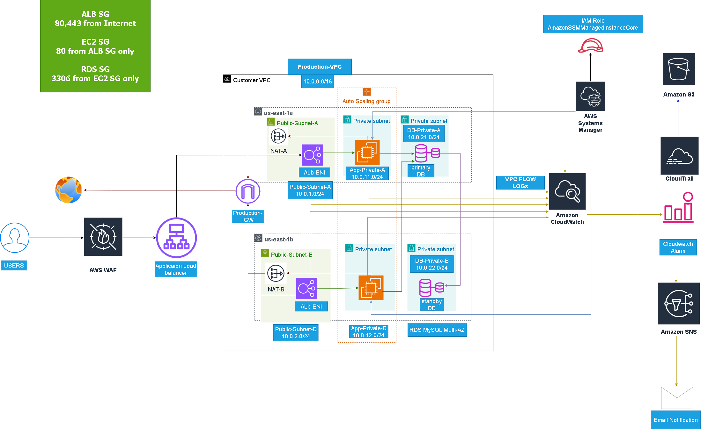
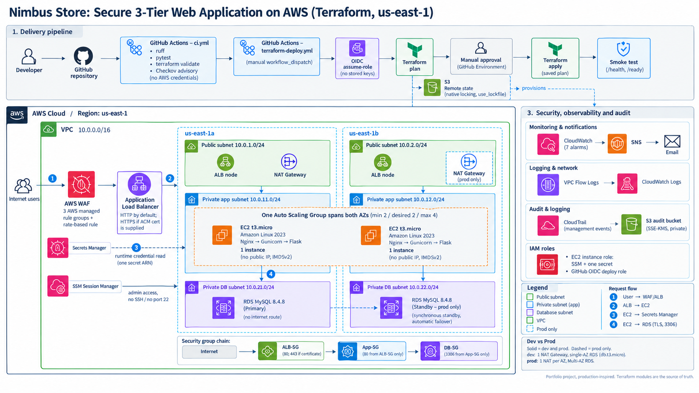
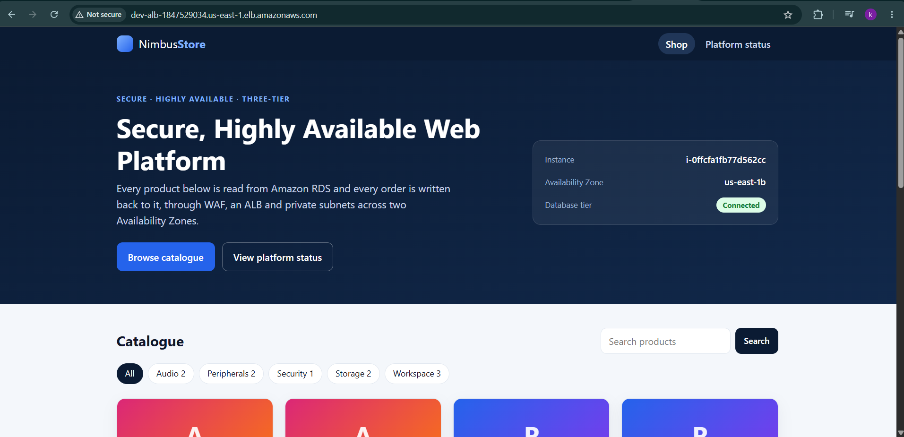
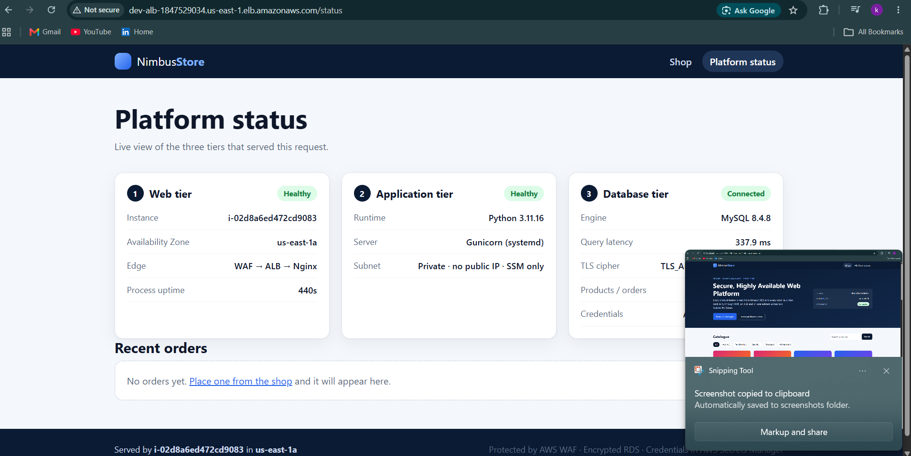
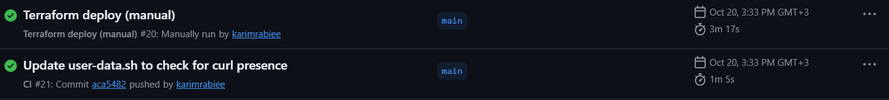

# AWS Secure & Highly Available 3-Tier Web Application

<div align="center">

[](https://aws.amazon.com/)
[](https://www.terraform.io/)
[](https://aws.amazon.com/rds/)
[](https://aws.amazon.com/waf/)
[](LICENSE)
[](https://github.com/karimrabiee/AWS-Secure-Scalable-Web-Application-Architecture/actions/workflows/ci.yml)
[](https://github.com/karimrabiee/AWS-Secure-Scalable-Web-Application-Architecture/actions/workflows/terraform-deploy.yml)

</div>

> A database-backed web application on private AWS infrastructure: designed, built by hand in the AWS Console, validated against failure conditions, then migrated to Terraform and delivered through a guarded GitHub Actions pipeline that authenticates with OIDC. It is a **portfolio project, production-inspired and not independently audited**.

**Lifecycle:** Design → Manual AWS Build → Failure-Condition Validation → Terraform Migration → CI/CD Delivery (OIDC) → Reproducible Infrastructure

---

## Architecture Evolution

Two diagrams are kept on purpose: the original design from the manual build, and the current view that includes Terraform and the CI/CD pipeline.

### 1. Initial architecture diagram



*The design used for the manual AWS build and validation phase, preserved unchanged for provenance.*

### 2. Current architecture (Terraform + CI/CD)



*Developer → GitHub Actions (validate, test, security checks, plan) → OIDC → manual approval → Terraform apply, into a two-AZ VPC with WAF, ALB, private EC2 Auto Scaling, private RDS MySQL, and the security and observability services. The Environments box shows the `dev` / `prod` differences.*

The diagram shows the full design: `dev` runs **one** NAT Gateway and single-AZ RDS, while `prod` runs one NAT Gateway per AZ and Multi-AZ RDS (primary plus standby). The lower-right note ("not yet executed against AWS") is historical: `dev` has since been deployed through the pipeline (see [Evidence Boundary](#evidence-boundary)).

### What changed between the two views?

| Area | Initial design | Current view |
|---|---|---|
| Delivery | Console | Terraform + GitHub Actions (OIDC, manual approval) |
| EC2 IAM role | `AmazonSSMManagedInstanceCore` | SSM **plus** read access to exactly one Secrets Manager secret (the RDS-managed credential) |
| Audit storage | S3 and CloudTrail | Private S3 with SSE-KMS; CloudTrail log-file validation |
| Application | Sample page | Nimbus Store (Flask + PyMySQL), database-backed |
| HTTPS | Not part of the drawing | Optional, conditional on a supplied ACM certificate |
| Scaling | Auto Scaling Group | CPU target tracking added (`enable_cpu_scaling`); scale-out not load-tested on the Terraform stack |

The initial diagram is a historical design artifact, not a one-to-one rendering of every Terraform resource. The current diagram plus the Terraform code are the implementation reference.

---

## The Application: Nimbus Store

A small, responsive storefront that makes the database tier real: products are read from RDS and orders are written back.

| Storefront | Platform status |
|---|---|
|  |  |

*Terraform-built `dev` environment, 2026-10-20. Owner-supplied screenshots (one instance each: `us-east-1b` and `us-east-1a`).*

| Route | Purpose |
|---|---|
| `/` | Product catalogue read from RDS (category filter, search) |
| `POST /api/orders` | Validated JSON order stored in RDS, tagged with the serving instance and AZ |
| `/status` | Platform status: serving instance/AZ, database state, latency, recent orders |
| `/health` | ALB health check. **Never touches the database**, so an RDS outage cannot make the ASG replace healthy instances |
| `/ready` | Readiness including a database round-trip (`503` when RDS is unreachable) |

How the database integration works (`terraform/modules/compute/app-src/db.py`):

- Credentials come from Secrets Manager at runtime; the password is never written to disk, user-data, Terraform variables or Git.
- Parameterized PyMySQL queries only; bounded timeouts; errors are mapped to generic messages (no stack traces, hosts or SQL shown to users).
- TLS with the public RDS CA bundle and host-name verification.
- The schema and 10 seed products are created idempotently on first start.
- **Rotation recovery:** on MySQL error 1045 the cached secret is dropped, re-read once and the connection retried, so a rotation does not require a redeploy (covered by an integration test against a real database).
- Known limitation: the app signs in as the RDS master user (the only credential RDS rotates natively). See [`docs/DECISIONS.md`](docs/DECISIONS.md).

## The Problem

A web application needs to stay available while keeping its servers and database off the public internet, with controlled access between tiers, no SSH exposure, and infrastructure that can be rebuilt reliably rather than reconstructed by hand.

## The Solution

```text
                         INTERNET
                            |
                            v
                         AWS WAF
                            |
                            v
                           ALB
                         /     \
                        v       v
                  EC2 / ASG   EC2 / ASG
                  Private AZ-A Private AZ-B
                        \       /
                         v     v
                        RDS MySQL
                         Multi-AZ (prod)

       CloudWatch ───► SNS        CloudTrail ───► S3
       Flow Logs  ───► CloudWatch  SSM ─────────► EC2
```

| Layer | Design |
|---|---|
| Network | VPC across 2 Availability Zones |
| Public entry | ALB + AWS WAF |
| Application | Private EC2, Auto Scaling, Nginx → Gunicorn → Flask ("Nimbus Store") |
| Database | Private RDS MySQL, Multi-AZ in prod; credential in Secrets Manager |
| Administration | SSM Session Manager, no SSH |
| Monitoring | CloudWatch + SNS |
| Auditing | CloudTrail + VPC Flow Logs |
| IaC and delivery | Terraform (modular, `dev`/`prod`), GitHub Actions with OIDC |

## Project Specifications

| | Initial validated build | Terraform (`dev` / `prod`) |
|---|---|---|
| Region | `us-east-1` | Variable, defaults `us-east-1` |
| VPC / AZs | `10.0.0.0/16`, 2 AZs, 6 subnets | Same |
| EC2 | `t3.micro`, Amazon Linux 2023 | Same instance type; AMI auto-discovered via SSM Parameter Store (pin optional) |
| Auto Scaling | Min 2 / Desired 2 / Max 4 | Same, configurable |
| RDS | MySQL 8.4.8, `db.m7g.large`, Multi-AZ | MySQL 8.4.8 default; `dev` = `db.t3.micro`, single-AZ; `prod` = instance class required explicitly (no silent default), Multi-AZ |
| RDS storage | 20 GiB gp3 | Same 20 GiB default; gp3 IOPS and throughput use the AWS defaults unless set |
| NAT Gateway | One per AZ | `dev` = 1 shared; `prod` = one per AZ |
| WAF | 3 managed rule groups | Same, plus a rate-based rule (2,000 requests / 5 min per IP) |
| Admin access | SSM Session Manager, no SSH | Same |
| Terraform / provider | n/a | `>= 1.10.0`, AWS provider `>= 5.60.0` |

The left column is what was built and tested manually (see [Validation](#validation)). `dev` and `prod` are intentionally different, not copies of each other; see [`docs/DECISIONS.md`](docs/DECISIONS.md).

## Security

```text
Internet → ALB-SG (80, and 443 once a certificate exists, from 0.0.0.0/0)
        → EC2-SG (port 80, from ALB-SG only)
        → RDS-SG (port 3306, from EC2-SG only)
```

Only the ALB accepts public traffic; every rule past it references a security group, never a raw CIDR. The EC2 role has `AmazonSSMManagedInstanceCore` and a read-only policy for **one** secret ARN (the RDS-managed credential).

| Control | Status |
|---|---|
| EC2 private, no public IP | ✅ |
| RDS private, no internet route | ✅ |
| No SSH, SSM Session Manager only | ✅ |
| IMDSv2 enforced, hop limit 1 | ✅ |
| IAM least privilege (SSM + one secret ARN on the instance role; scoped `PassRole` on the CI role) | ✅ |
| Database credential never in Git / user-data / disk; TLS with CA and host-name verification | ✅ |
| AWS WAF: managed rules + rate limiting | ✅ |
| RDS encryption at rest, automated backups | ✅ |
| CloudTrail (management events) + VPC Flow Logs | ✅ |
| OIDC for CI/CD, no stored AWS keys | ✅ |

AWS WAF uses AWS Managed Rules to help block common web exploits and known-bad traffic. This is threat mitigation, not a guarantee. Full detail: [`docs/SECURITY-CONTROL.md`](docs/SECURITY-CONTROL.md)

## High Availability

| Component | Mechanism |
|---|---|
| ALB | Spans both AZs, routes only to healthy targets |
| EC2 | Auto Scaling Group, minimum two instances spread across both AZs |
| RDS | Multi-AZ in prod: synchronous standby, automatic failover |
| NAT | One per AZ in prod, so one AZ's issue does not affect outbound traffic in the other |

On an AZ failure, the ALB stops routing to it and the ASG attempts a replacement in the healthy AZ, subject to available capacity. This is the design intent, not a guarantee independent of AWS-side conditions. A real Multi-AZ failover was performed during the manual build and completed in under one minute (see [Validation](#validation)).

## Monitoring and Auditing

The Terraform-managed stack defines 7 CloudWatch alarms. All publish to one SNS topic; an email subscription is created only when `alarm_email` is supplied and the recipient confirms it.

| Alarm | Metric |
|---|---|
| EC2 high CPU | `AWS/EC2 CPUUtilization` |
| ALB unhealthy targets | `AWS/ApplicationELB UnHealthyHostCount` |
| ALB 5xx | `AWS/ApplicationELB HTTPCode_Target_5XX_Count` |
| ALB p95 latency | `AWS/ApplicationELB TargetResponseTime` |
| RDS high CPU | `AWS/RDS CPUUtilization` |
| RDS low free storage | `AWS/RDS FreeStorageSpace` |
| RDS connection count | `AWS/RDS DatabaseConnections` |

CloudTrail records management events to an encrypted S3 bucket; VPC Flow Logs stream to CloudWatch Logs.

## Terraform

```text
terraform/
├── bootstrap/            # S3 state bucket, run once
├── environments/
│   ├── dev/
│   └── prod/
└── modules/
    ├── networking/  security/  alb/  waf/
    └── compute/     database/  monitoring/  security-services/
```

Reusable modules · `dev`/`prod` separation · S3 remote state with native locking (`use_lockfile`, no DynamoDB) · Amazon Linux 2023 AMI auto-discovery · optional HTTPS via `certificate_arn` · RDS deletion protection in prod.

### Quick Start

```bash
cd terraform/bootstrap
terraform init && terraform apply

cd ../environments/dev
cp terraform.tfvars.example terraform.tfvars
cp backend.hcl.example backend.hcl
terraform init -backend-config=backend.hcl
terraform plan
terraform apply
```

PowerShell: replace `cp` with `Copy-Item`. No domain or ACM certificate is required for the default HTTP deployment. HTTPS can be enabled with a valid ACM certificate ARN in `certificate_arn`.

Full workflow and troubleshooting: [`terraform/README.md`](terraform/README.md) · [`docs/OPERATIONS.md`](docs/OPERATIONS.md)

### Automated Validation

`.github/workflows/ci.yml` (no AWS credentials, never applies anything) runs: `ruff`, the pytest suite (60 tests) on Python 3.11 and 3.12 **including real-database integration tests against a `mysql:8.4` service container**, `terraform fmt`, backend-free `init` + `validate` for bootstrap/dev/prod, a repository-hygiene scan (secrets, state files, conflict markers), `actionlint`, `pip-audit`, and an advisory Checkov scan. Locally: `pip install -r requirements-dev.txt && pytest -q`.

## Evidence Boundary

Different kinds of evidence are kept separate and are not interchangeable:

| Evidence | Environment | Meaning |
|---|---|---|
| RDS failover, WAF blocking, SNS, SSM, Flow Logs screenshots | Original manual build | The design was exercised manually; this does not prove Terraform recreated the same state |
| `pytest`, `ruff`, `terraform fmt`/`validate`, `actionlint`, `pip-audit`, Checkov | Repository (verified locally 2026-10-20) | Code and configuration are valid; this does not prove AWS runtime behaviour |
| CI #21 and Terraform deploy #20 (`/health` and `/ready` returned 200) | Terraform-built `dev` | Documented, owner-supplied: [CI #21](https://github.com/karimrabiee/AWS-Secure-Scalable-Web-Application-Architecture/actions/runs/39423145695) · [deploy #20](https://github.com/karimrabiee/AWS-Secure-Scalable-Web-Application-Architecture/actions/runs/39423190369) · [screenshot](validation-tests/github-actions-deploy20-ci21-2026-10-20.png). Deploy #20 was an in-place update, not a from-scratch deployment |
| Failover, WAF and load tests on the Terraform stack | Not done | No performance figure is claimed |

The project is presented as **production-inspired** until a from-scratch deployment and repeatable validation are recorded for the Terraform stack. Details: [`docs/TEST-RESULTS.md`](docs/TEST-RESULTS.md).

## Validation

> Results below are from the original, manually built environment, before the Terraform migration.

| Test | Result |
|---|---|
| RDS Multi-AZ failover | ✅ Completed in under one minute |
| WAF XSS blocking | ✅ 539 of 699 test requests blocked in that run |
| Auto Scaling | ✅ The manual build maintained desired capacity across both AZs |
| SNS email alert | ✅ Delivered |
| SSM Session Manager | ✅ No port 22, IAM-authenticated |
| VPC Flow Logs / CloudTrail | ✅ Traffic and management events captured |


<details>
<summary><strong>Screenshots: manual AWS build (every layer)</strong></summary>

| | |
|---|---|
|  |  |
|  |  |
|  |  |
|  |  |
|  |  |
|  |  |
|  |  |
|  |  |

</details>

## Documentation

| File | Covers |
|---|---|
| [`terraform/README.md`](terraform/README.md) | Terraform workflow and module reference |
| [`docs/ARCHITECTURE.md`](docs/ARCHITECTURE.md) | Full architecture detail |
| [`docs/DECISIONS.md`](docs/DECISIONS.md) | Why each design choice was made |
| [`docs/SECURITY-CONTROL.md`](docs/SECURITY-CONTROL.md) | Security design reference |
| [`docs/CI-CD.md`](docs/CI-CD.md) | Workflows, OIDC, guards, local commands |
| [`docs/iam/README.md`](docs/iam/README.md) | OIDC role and deploy policy templates |
| [`docs/OPERATIONS.md`](docs/OPERATIONS.md) | Deploying, testing and tearing down the Terraform stack |
| [`docs/TEST-RESULTS.md`](docs/TEST-RESULTS.md) | Tests, evidence, Checkov classification, what is not proven |
| [`docs/TROUBLESHOOTING.md`](docs/TROUBLESHOOTING.md) | Issues hit and how they were resolved |
| [`docs/FINDINGS-AND-FIXES.md`](docs/FINDINGS-AND-FIXES.md) | Real defects, root causes and fixes |
| [`docs/LESSONS-LEARNED.md`](docs/LESSONS-LEARNED.md) | Key takeaways from the migration |
| [`docs/COST-ANALYSIS.md`](docs/COST-ANALYSIS.md) | Cost breakdown and assumptions |
| [`docs/DEPLOYMENT-GUIDE.md`](docs/DEPLOYMENT-GUIDE.md) | The original manual build, phase by phase |

## Cost

Main drivers: RDS, NAT Gateways, ALB, WAF, CloudWatch. `dev` defaults to the cheaper end (1 NAT, single-AZ RDS, `db.t3.micro`); `prod` requires an explicit instance class. Hourly figures in [`docs/COST-ANALYSIS.md`](docs/COST-ANALYSIS.md) are estimates based on mid-2025 prices, not current pricing. Destroy environments when not in use; NAT Gateways and RDS bill hourly regardless of traffic.

## CI/CD and Deployment Workflow

Deployment is a **manual** `workflow_dispatch` run of [`.github/workflows/terraform-deploy.yml`](.github/workflows/terraform-deploy.yml): OIDC (no stored keys) → plan → human approval via the GitHub Environment → apply of the *saved* plan → smoke test of `/health` and `/ready`.

- The state key is fixed to `ecomm-platform/<environment>/terraform.tfstate`, the same key as `backend.hcl.example`, so a laptop and CI always use the **same** state. A mismatched key makes Terraform believe nothing exists and re-create everything (`EntityAlreadyExists`, `VpcLimitExceeded`); that was the root cause of an earlier failed run.
- Guards: refuses an **empty** state unless `allow_fresh_state` is ticked; refuses any plan that deletes or replaces resources unless `allow_destroy` is ticked; per-environment concurrency group; `-lock-timeout`.
- Required Environment variables: `AWS_DEPLOY_ROLE_ARN`, `TF_STATE_BUCKET` (`AWS_REGION` optional, `TF_DB_INSTANCE_CLASS` required for prod, `TF_ALARM_EMAIL` optional).
- Reference IAM policies: [`docs/iam/`](docs/iam/). Runbooks: [`docs/CI-CD.md`](docs/CI-CD.md).

## Known Limitations

- No from-scratch deployment of the Terraform stack is recorded yet (deploy #20 was an in-place update of `dev`); `prod` has not been deployed.
- Failover, WAF and load tests exist only for the manual build.
- The application signs in as the RDS master user; no dedicated DB user yet.
- EC2 user-data is limited to 16 KB by AWS; the app is therefore small and embedded gzip-compressed (a test guards the size).
- Default deployment is HTTP; HTTPS needs an ACM certificate (`certificate_arn`).
- Checkov (advisory) reports 39 findings (229 passed), classified in [`docs/TEST-RESULTS.md`](docs/TEST-RESULTS.md) as cost/scope trade-offs, design limitations, likely false positives and future tickets.

## Future Improvements

Record one from-scratch deploy and teardown · HTTPS with ACM · dedicated least-privilege database user · failover and load tests on the Terraform stack. Route 53 remains outside this implementation scope.

## Cleanup

```bash
cd terraform/environments/dev   # or prod
terraform plan -destroy
terraform destroy               # manual, deliberate, never from CI
```

`prod` uses RDS deletion protection. To destroy it, disable deletion protection in the production configuration, apply the change, and then run `terraform destroy`. Destroy the `bootstrap` state bucket only after no environment depends on it. Safe order: [`docs/OPERATIONS.md`](docs/OPERATIONS.md) §14.

## License

[MIT](LICENSE)

## Author

**Karim Rabie**

Junior Cloud Engineer | AWS | Terraform | Docker | Cloud Infrastructure

[LinkedIn](https://www.linkedin.com/in/karim-rabiee) · [GitHub](https://github.com/karimrabiee)