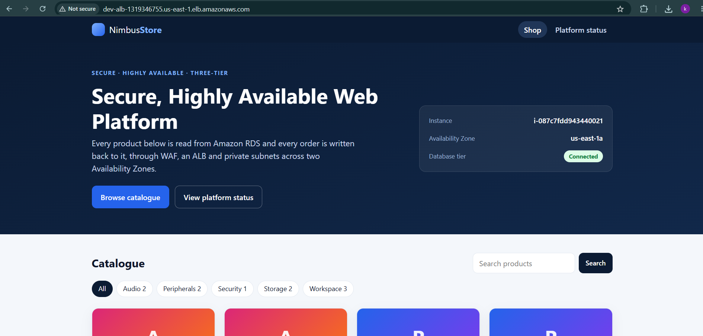
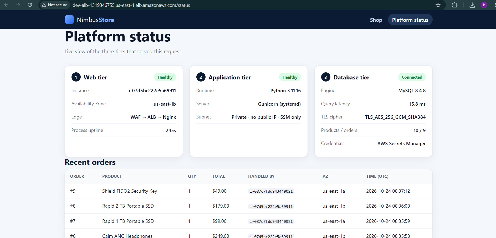
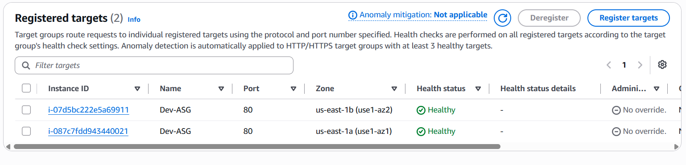
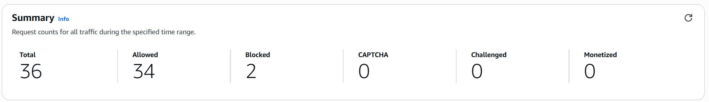
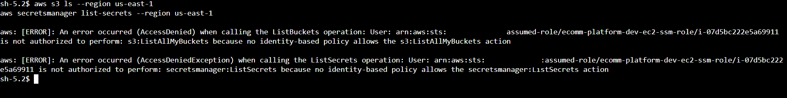

# AWS Secure & Highly Available 3-Tier Web Application

<div align="center">

[](https://aws.amazon.com/)
[](https://www.terraform.io/)
[](https://aws.amazon.com/rds/)
[](https://aws.amazon.com/waf/)
[](LICENSE)
[](https://github.com/karimrabiee/AWS-Secure-Scalable-Web-Application-Architecture/actions/workflows/ci.yml)
[](https://github.com/karimrabiee/AWS-Secure-Scalable-Web-Application-Architecture/actions/workflows/terraform-deploy.yml)

</div>

> A database-backed web application on private AWS infrastructure: designed, built by hand in the AWS Console, validated against failure conditions, then migrated to Terraform and delivered through a guarded GitHub Actions pipeline that authenticates with OIDC. It is a **portfolio project, production-inspired and not independently audited**.

**Lifecycle:** Design → Manual AWS Build → Failure-Condition Validation → Terraform Migration → CI/CD Delivery (OIDC) → Reproducible Infrastructure

---

## The Problem

A web application has to stay available while its servers and database stay off the public internet. That means controlled access between tiers, no SSH exposure, no database password in code, and infrastructure that can be rebuilt from code instead of reconstructed by hand. This project solves it with a private two-AZ AWS design, first proven manually, then codified in Terraform and delivered through a guarded pipeline.

---

## Architecture

### 1. Current architecture (Terraform + CI/CD)


*Developer → GitHub Actions (validate, test, security checks, plan) → OIDC → manual approval → Terraform apply, into a two-AZ VPC with WAF, ALB, private EC2 Auto Scaling, private RDS MySQL, and the security and observability services. The Environments box shows the `dev` / `prod` differences.*

The diagram shows the intended architecture: `dev` runs **one** NAT Gateway and single-AZ RDS, while `prod` runs one NAT Gateway per AZ and Multi-AZ RDS (primary plus standby). The `dev` environment has been deployed through the pipeline; see [Evidence and limitations](#evidence-and-limitations) for the verified scope.

### 2. Initial architecture (manual build)


*The original design used for the manual AWS build and validation phase, preserved unchanged for provenance.*

---

## Highlights

| | |
|---|---|
| **Private by design** | Only the ALB is public. EC2 and RDS sit in private subnets, security groups chain ALB → app → database, and there is no SSH (Session Manager only). |
| **No passwords in code** | RDS manages its master credential in Secrets Manager; the EC2 role can read that one secret and the app recovers when it rotates. |
| **Two-AZ layout** | ALB, Auto Scaling Group (min 2 / max 4) and subnets span two AZs; `prod` adds Multi-AZ RDS and one NAT Gateway per AZ. |
| **Reproducible** | 8 Terraform modules, separate `dev` / `prod`, S3 remote state with native locking. |
| **Guarded delivery** | OIDC (no stored keys), saved plan, manual approval, empty-state and destroy guards, `/health` + `/ready` smoke test. |
| **Observable** | 7 CloudWatch alarms to SNS, CloudTrail management events, VPC Flow Logs. |

## Running project

| Storefront | Platform status |
|---|---|
|  |  |

*Terraform-built `dev` environment, 2026-10-20. Owner-supplied screenshots (one instance each: `us-east-1b` and `us-east-1a`).*

The application, **Nimbus Store**, is a small Flask storefront (Nginx → Gunicorn → Flask) that reads products from RDS and writes orders back. `/health` never touches the database, so an RDS outage cannot make the ASG replace healthy instances; `/ready` includes a database round-trip.

## Validation evidence
A dated owner-run validation session checked the Terraform-built `dev` stack from the AWS CLI, an SSM session and the Console, then tore it down. The evidence is intentionally classified as verified, documented, historical, partial or not done; it is not presented as an independent audit. See [`docs/TEST-RESULTS.md`](docs/TEST-RESULTS.md) for the full table, commands and limits.

| Check | Result |
|---|---|
| App through the ALB; orders served by instances in both AZs | ✅ HTTP 200, 2 of 2 targets healthy, orders handled by `us-east-1a` and `us-east-1b` |
| Servers private, IMDSv2 required | ✅ no public IP on either instance, `HttpTokens=required`, token-less metadata call returns 401 |
| Database private and encrypted | ✅ `PubliclyAccessible=False`, `StorageEncrypted=True` (`MultiAZ=False` by design in `dev`) |
| No SSH | ✅ no security-group rule on port 22 in the VPC; access through Session Manager |
| WAF | ✅ normal request 200; XSS query string 403; `sqlmap` user agent 403; web ACL summary 36 requests, 2 blocked |
| Least-privilege instance role | ✅ `s3:ListAllMyBuckets` and `secretsmanager:ListSecrets` denied |
| Outbound path through NAT | ⚠️ public egress address seen from a private instance; NAT address not captured alongside |
| CloudWatch alarms to SNS | ⚠️ alarms exist, but the SNS subscription was left unconfirmed, so e-mail delivery is **not** verified |
| Multi-AZ failover, NAT per AZ | ➖ `prod` only; the failover result below is from the manual build |

| App served from both AZs | Targets healthy |
|---|---|
|  |  |
|  |  |

*Not recorded in this repository (no archived output, so no claim): instance self-healing, scale-out under load, CloudTrail and Flow Logs queries, teardown output.*

## How it works

```text
Internet → AWS WAF → ALB (public subnets, 2 AZs)
                       → EC2 Auto Scaling Group (private subnets)  Nginx → Gunicorn → Flask
                           → RDS MySQL 8.4.8 (private DB subnets, encrypted)
                           → Secrets Manager (one secret, read at runtime)
Operations: SSM Session Manager · CloudWatch + SNS · CloudTrail → S3 · VPC Flow Logs
Delivery:   GitHub Actions → OIDC → plan → approval → apply → smoke test
```

| Environment | NAT Gateways | RDS | Deletion protection |
|---|---|---|---|
| `dev` | 1 shared | `db.t3.micro`, single-AZ | Off |
| `prod` | 1 per AZ | Class set explicitly, Multi-AZ | On |

## Key design choices and security

| Choice | Detail | Details in |
|---|---|---|
| Private subnets | EC2 and RDS have no public IP; DB subnets have no internet route | [`ARCHITECTURE.md`](docs/ARCHITECTURE.md) |
| Security-group chaining | ALB-SG → App-SG → DB-SG, no raw CIDR past the ALB | [`SECURITY-CONTROL.md`](docs/SECURITY-CONTROL.md) |
| SSM instead of SSH | No port 22; access through Session Manager | [`SECURITY-CONTROL.md`](docs/SECURITY-CONTROL.md) |
| IMDSv2 | Required, hop limit 1 | [`SECURITY-CONTROL.md`](docs/SECURITY-CONTROL.md) |
| Secrets Manager | RDS-managed password; TLS to RDS with host-name verification | [`DECISIONS.md`](docs/DECISIONS.md) |
| WAF | 3 AWS managed rule groups plus a rate-based rule (mitigation, not a guarantee) | [`SECURITY-CONTROL.md`](docs/SECURITY-CONTROL.md) |
| OIDC for CI/CD | No stored AWS keys; role scoped to this repository and environment | [`CI-CD.md`](docs/CI-CD.md) |
| Remote state | S3, `use_lockfile`, key `ecomm-platform/<env>/terraform.tfstate` | [`DECISIONS.md`](docs/DECISIONS.md) |

## Evidence and limitations

| Claim | Status | Reference |
|---|---|---|
| 60 tests (Python 3.11 and 3.12; 9 need a real database), ruff, pip-audit, actionlint, `terraform fmt` | Verified in the documented review run | [`docs/TEST-RESULTS.md`](docs/TEST-RESULTS.md) |
| 7 CloudWatch alarms defined | Verified in code | [`monitoring/main.tf`](terraform/modules/monitoring/main.tf) |
| A documented CI and Terraform `dev` run passed; `/health` and `/ready` returned 200 | Owner-supplied evidence, not a current live-status check | [`docs/TEST-RESULTS.md`](docs/TEST-RESULTS.md) |
| App serves from `dev` with the database connected | Documented (dated screenshots) | [`validation-tests/`](validation-tests) |
| RDS failover under 1 minute; WAF blocked 539 of 699 XSS test requests | Historical (manual build only) | [`validation-tests/`](validation-tests) |
| `dev` validation: private servers and RDS, IMDSv2, no port 22, WAF 403s, least-privilege role, targets in both AZs | Documented: owner-run 2026-10-24, logs and screenshots archived | [`validation-tests/terraform-dev/`](validation-tests/terraform-dev) · [`docs/TEST-RESULTS.md`](docs/TEST-RESULTS.md) |
| Alarm e-mail delivery, self-healing, scale-out, CloudTrail and Flow Logs queries, teardown output | Not recorded (no archived evidence) | [`docs/TEST-RESULTS.md`](docs/TEST-RESULTS.md) |
| RDS failover and load test on the Terraform stack; `prod` deploy | Not done | [`docs/TEST-RESULTS.md`](docs/TEST-RESULTS.md) |
| Checkov (advisory): 229 passed / 39 findings, classified | Verified locally | [`docs/TEST-RESULTS.md`](docs/TEST-RESULTS.md) |

**Known limitations:** HTTP by default (HTTPS needs your ACM `certificate_arn`) · the app connects as the RDS master user · alarm e-mail delivery was not verified in the validation run (unconfirmed SNS subscription) · GuardDuty, Security Hub, AWS Config and customer-managed KMS keys are not implemented.

<details>
<summary><strong>Manual-build screenshots (historical)</strong></summary>

| | |
|---|---|
|  |  |
|  |  |
|  |  |
|  |  |
|  |  |
|  |  |
|  |  |
|  |  |

</details>

## Quick start

Needs an AWS account, Terraform 1.10+ and the AWS CLI. For the pipeline, also a GitHub OIDC role ([`docs/iam/README.md`](docs/iam/README.md)).

```bash
cd terraform/bootstrap && terraform init && terraform apply     # state bucket, once
cd ../environments/dev
cp terraform.tfvars.example terraform.tfvars                    # PowerShell: Copy-Item
cp backend.hcl.example backend.hcl
terraform init -backend-config=backend.hcl
terraform plan
terraform apply
```

Or run **Actions → Terraform deploy (manual)**, choose `dev`, review the plan and approve. Run the tests with `pip install -r requirements-dev.txt && pytest -q`. More: [`terraform/README.md`](terraform/README.md) · [`docs/OPERATIONS.md`](docs/OPERATIONS.md)


## Release contract

The repository is ready for a reviewed `dev` deployment when the local checks and the CI workflow are green. A green CI run proves source and configuration checks; it does not prove that AWS quotas, OIDC permissions, the remote state object or the selected account are correct.

The deployment workflow is deliberately manual. It refuses an empty remote state unless `allow_fresh_state=true`, blocks destructive plans unless `allow_destroy=true`, stores the reviewed plan as an artifact, and runs bounded `/health` and `/ready` smoke tests after apply. Never bypass these guards by applying from an unrelated local state.

Before using `prod`, supply a real ACM certificate ARN, an intentional RDS instance class, a confirmed alarm email, and a reviewed cost estimate. Do not commit `terraform.tfvars`, `backend.hcl`, state files or plan files.

## Repository structure

```text
terraform/         bootstrap/ · environments/{dev,prod}/ · modules/{networking,security,alb,waf,compute,database,monitoring,security-services}
.github/workflows/ ci.yml · terraform-deploy.yml
tests/             unit, database-integration and infrastructure-contract tests
architecture/      initial and current diagrams
docs/              architecture, decisions, security, CI/CD, operations, test results
screenshots/ validation-tests/   manual-build evidence, live dev captures, terraform-dev/ logs and screenshots
```

## Documentation

| Doc | Purpose |
|---|---|
| [`ARCHITECTURE.md`](docs/ARCHITECTURE.md) · [`DECISIONS.md`](docs/DECISIONS.md) | What is built and why |
| [`SECURITY-CONTROL.md`](docs/SECURITY-CONTROL.md) · [`CI-CD.md`](docs/CI-CD.md) · [`iam/`](docs/iam/README.md) | Security controls, pipeline and OIDC |
| [`OPERATIONS.md`](docs/OPERATIONS.md) · [`TROUBLESHOOTING.md`](docs/TROUBLESHOOTING.md) | Deploy, test, tear down, fix errors |
| [`TEST-RESULTS.md`](docs/TEST-RESULTS.md) · [`FINDINGS-AND-FIXES.md`](docs/FINDINGS-AND-FIXES.md) | Evidence and real problems solved |
| [`COST-ANALYSIS.md`](docs/COST-ANALYSIS.md) · [`DEPLOYMENT-GUIDE.md`](docs/DEPLOYMENT-GUIDE.md) | Cost estimates; the original manual build |

Full index: [`docs/README.md`](docs/README.md)

## Cost and cleanup

NAT Gateways, RDS, ALB and WAF are billed by the hour while they exist. Use `dev`, set a budget alert, and destroy when finished. Teardown is manual only: `terraform plan -destroy`, then `terraform destroy` ([`docs/OPERATIONS.md`](docs/OPERATIONS.md) §14). `prod` has RDS deletion protection on. Figures in [`docs/COST-ANALYSIS.md`](docs/COST-ANALYSIS.md) are estimates from mid-2025 prices, not current pricing.

## License

[MIT](LICENSE)

## Author

**Karim Rabie**

Junior Cloud Engineer | AWS | Terraform | Docker | K8s | CI/CD | Cloud Infrastructure

[LinkedIn](https://www.linkedin.com/in/karim-rabiee) · [GitHub](https://github.com/karimrabiee)
