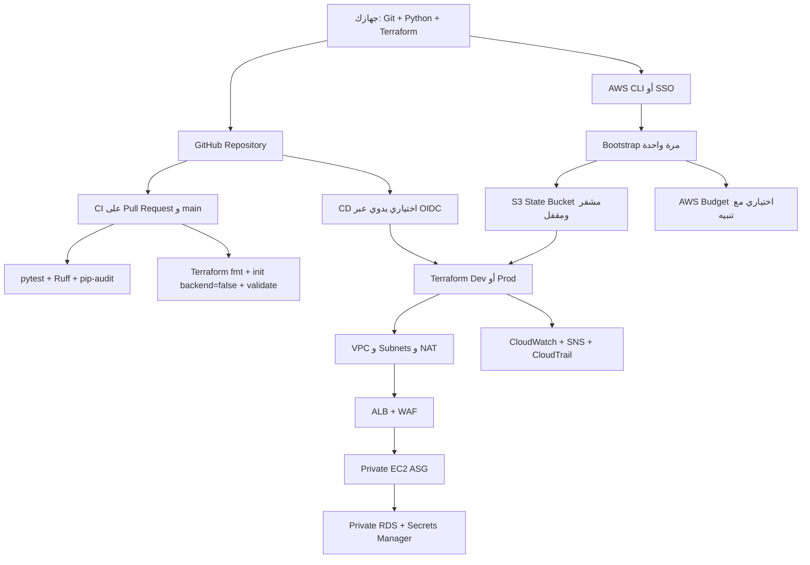

# دليل تنفيذ المشروع باحترافية — بدون Route 53

هذا الدليل يشرح تنفيذ المشروع من الصفر حتى النشر على GitHub، ثم تشغيل بيئة AWS تدريجيًا. الهدف هو تنفيذ آمن وقابل للتكرار، وليس تشغيل كل شيء دفعة واحدة.

> **قاعدة مهمة:** لا تنفّذ `terraform apply` أو `terraform destroy` قبل قراءة الخطة (`terraform plan`) والتأكد من الحساب والمنطقة والبيئة. لا يحتوي هذا التصميم على Route 53، ولا يحتاج Domain أو DNS حتى يعمل عبر رابط ALB.

## 1. الصورة الكاملة



## 2. المتطلبات على جهازك

ثبّت الإصدارات التالية أو إصدارات أحدث متوافقة:

- Git
- Python 3.12
- Terraform `>= 1.10.0, < 2.0.0`
- AWS CLI v2
- حساب AWS بصلاحيات مختبر مناسبة

تحقق من الأدوات:

```bash
git --version
python3 --version
terraform version
aws --version
```

لا تضع Access Key أو Secret Key داخل المستودع أو داخل ملفات `tfvars`. استخدم AWS IAM Identity Center/SSO إن كان متاحًا:

```bash
aws configure sso
aws sso login --profile portfolio
export AWS_PROFILE=portfolio
aws sts get-caller-identity
```

في PowerShell:

```powershell
$env:AWS_PROFILE = "portfolio"
aws sso login --profile portfolio
aws sts get-caller-identity
```

يجب أن يظهر الحساب الصحيح قبل أي Terraform command.

## 3. تجهيز المشروع

استخرج الإصدار النهائي ثم ادخل إلى مجلد المشروع:

```bash
unzip AWS-Secure-Scalable-Web-Application-Architecture-CI-CD-Final.zip
cd AWS-Secure-Scalable-Web-Application-Architecture-CI-CD-Final
```

شغّل الاختبارات المحلية قبل AWS:

```bash
python3 -m venv .venv
. .venv/bin/activate
python -m pip install -r terraform/modules/compute/app-src/requirements.txt -r requirements-dev.txt
python -m py_compile terraform/modules/compute/app-src/app.py
ruff check .
pytest -q
python scripts/check-repository-hygiene.py
pip-audit -r terraform/modules/compute/app-src/requirements.txt
```

في PowerShell:

```powershell
py -m venv .venv
.\.venv\Scripts\Activate.ps1
python -m pip install -r terraform/modules/compute/app-src/requirements.txt -r requirements-dev.txt
python -m py_compile terraform/modules/compute/app-src/app.py
ruff check .
pytest -q
```

## 4. تشغيل Bootstrap مرة واحدة

الـ Bootstrap ينشئ S3 bucket خاصًا بـ Terraform state وBudget على مستوى الحساب. لا تستخدم Backend S3 للـ Bootstrap نفسه؛ لأن الـ bucket لم يكن موجودًا قبل التنفيذ.

```bash
cd terraform/bootstrap
cp terraform.tfvars.example terraform.tfvars
```

افتح `terraform.tfvars` وضع قيمًا غير سرية مثل اسم المشروع والمنطقة. لا تضع بريدًا حقيقيًا داخل ملف سيُرفع إلى GitHub. للبريد استخدم متغير البيئة:

```bash
export TF_VAR_budget_email="your-email@example.com"
terraform init
terraform fmt -check
terraform validate
terraform plan -out=bootstrap.tfplan
```

اقرأ الخطة. إذا كان الحساب والمنطقة والـ budget صحيحين فقط نفّذ:

```bash
terraform apply bootstrap.tfplan
```

احفظ اسم الـ bucket الناتج:

```bash
terraform output -raw bucket_name
```

> قد يرسل AWS Budget رسالة تأكيد للبريد. Budget هو تنبيه وليس سقف إنفاق فعليًا؛ راقب Billing Console أيضًا.

## 5. تشغيل بيئة Dev أولًا

ابدأ بـ `dev` لأنها أقل تكلفة: NAT Gateway واحد وRDS صغير وبدون deletion protection.

```bash
cd ../environments/dev
cp terraform.tfvars.example terraform.tfvars
cp backend.hcl.example backend.hcl
```

افتح `backend.hcl` واستبدل `replace_by_bucket_name` باسم bucket الناتج من Bootstrap. لا تغيّر `use_lockfile = true`.

ثم نفّذ:

```bash
terraform init -backend-config=backend.hcl
terraform fmt -check
terraform validate
terraform plan -out=dev.tfplan
```

راجع أهم الموارد التي ستُنشأ: VPC، Internet Gateway، NAT Gateway، ALB، WAF، Auto Scaling Group، RDS، CloudWatch، CloudTrail، وS3 logs. إذا كانت الخطة مقصودة فقط:

```bash
terraform apply dev.tfplan
```

بعد اكتمال الإنشاء، اعرض رابط ALB:

```bash
terraform output -raw alb_dns_name
```

اختبر التطبيق:

```bash
curl http://ALB_DNS_NAME/health
curl http://ALB_DNS_NAME/
```

المتوقع من health هو `OK`. الصفحة الرئيسية تعرض Availability Zone وInstance ID، ولا تعرض كلمة مرور أو Secret.

## 6. تشغيل Prod — بعد نجاح Dev فقط

لا تبدأ بـ `prod`. البيئة الإنتاجية أغلى وتستخدم NAT Gateway لكل Availability Zone وRDS Multi-AZ وdeletion protection.

```bash
cd ../prod
cp terraform.tfvars.example terraform.tfvars
cp backend.hcl.example backend.hcl
```

ضع اسم bucket الصحيح وغيّر key إلى مسار منفصل، مثل:

```hcl
bucket       = "اسم-الباكت-الحقيقي"
key          = "ecomm-platform/prod/terraform.tfstate"
region       = "us-east-1"
use_lockfile = true
```

لأن `db_instance_class` في prod مطلوب عمدًا، أضف في ملف محلي gitignored:

```hcl
db_instance_class = "db.t3.micro"
```

اختر instance class مناسبة فعلًا قبل الاستخدام الحقيقي، ولا تعتبر `db.t3.micro` اختيارًا إنتاجيًا تلقائيًا. بعد ذلك:

```bash
terraform init -backend-config=backend.hcl
terraform fmt -check
terraform validate
terraform plan -out=prod.tfplan
```

نفّذ `apply` فقط بعد مراجعة الخطة والموافقة على التكلفة:

```bash
terraform apply prod.tfplan
```

## 7. ما الذي يحدث داخل AWS؟

1. المستخدم يصل إلى ALB العام.
2. AWS WAF يفحص الطلبات ويطبّق Managed Rules وRate Limit.
3. ALB يرسل الطلب إلى EC2 داخل Private Subnets.
4. EC2 يعمل خلف Nginx وGunicorn وFlask.
5. RDS موجود في Private Subnets ولا يقبل الاتصال إلا من Security Group الخاصة بالتطبيق.
6. كلمة مرور RDS ينشئها RDS داخل Secrets Manager، ولا توجد داخل Terraform variables.
7. SSM Session Manager هو طريق الإدارة؛ لا يوجد SSH ولا Port 22.
8. CloudWatch وSNS يراقبان الأعطال، وCloudTrail وVPC Flow Logs يسجلان الأحداث والمرور الشبكي.

## 8. نشر المشروع على GitHub باحترافية

أنشئ مستودعًا فارغًا على GitHub، ثم من مجلد المشروع:

```bash
git init
git branch -M main
git add .
git diff --cached --check
git commit -m "Prepare AWS architecture with CI and gated Terraform deployment"
git remote add origin https://github.com/USERNAME/REPOSITORY.git
git push -u origin main
```

قبل الرفع، تحقق ألا توجد ملفات حقيقية باسم `terraform.tfvars`, `backend.hcl`, state, plans, credentials أو private keys. بعد Push:

1. افتح تبويب **Actions**.
2. انتظر تشغيل `CI`.
3. أصلح أي فشل قبل تفعيل CD.
4. فعّل Branch Protection على `main` واجعل CI checks مطلوبة قبل الدمج.
5. لا ترفع `.git` القديم الموجود داخل الأرشيف إلى مستودع عام جديد.

## 9. إعداد CD الاختياري عبر OIDC

لا تحتاج CD لتشغيل المشروع يدويًا. استخدمه فقط بعد نجاح Dev وفهم خطة Terraform.

في GitHub أنشئ Environments باسم **dev** و**prod**. أضف Reviewers إلى `prod`. أضف Environment Variables التالية:

| المتغير | الغرض |
|---|---|
| `AWS_DEPLOY_ROLE_ARN` | ARN لدور IAM مخصص لـ GitHub OIDC |
| `AWS_REGION` | مثل `us-east-1` |
| `TF_STATE_BUCKET` | اسم S3 state bucket من Bootstrap |
| `TF_STATE_KEY` | اختياري؛ الافتراضي `ecomm-platform/<env>/terraform.tfstate` ويجب أن يطابق مفتاح الـ state الأصلي |
| `TF_DB_INSTANCE_CLASS` | مطلوب لـ prod، مثل `db.t3.micro` للاختبار فقط |
| `TF_ALARM_EMAIL` | اختياري لتنبيهات SNS |

قيّد Trust Policy الخاصة بالدور بالمستودع والفرع والـ Environment المقصود. لا تستخدم Access Keys طويلة المدى داخل GitHub Secrets. الـ Workflow اليدوي يقوم بـ plan أولًا ثم apply فقط إذا اخترت ذلك، ومع حماية Environment يجب أن تنتظر الموافقة المطلوبة.

## 10. التحقق والتكلفة والتنظيف

لا تعتبر `terraform validate` دليلًا على نجاح AWS. بعد deployment اختبر `/health`، حالة Target Group، ASG، RDS، WAF، SSM، CloudWatch، وCloudTrail وسجّل النتائج.

عند الانتهاء من Dev:

```bash
cd terraform/environments/dev
terraform plan -destroy -out=dev-destroy.tfplan
terraform apply dev-destroy.tfplan
```

لا تدمر Prod casually. راجع النسخ الاحتياطية وdeletion protection أولًا. لا تدمر Bootstrap state bucket إلا بعد تدمير البيئات التي تستخدمه والتأكد من عدم الحاجة إلى state.

## 11. المسار الاحترافي المختصر

```text
Install tools
  → Confirm AWS account with sts get-caller-identity
  → Run local Python and Terraform checks
  → Bootstrap state bucket + budget
  → Deploy dev
  → Test ALB /health and AWS controls
  → Push to GitHub and make CI required
  → Configure OIDC only if needed
  → Review plan manually
  → Deploy prod only with approval
  → Record evidence and destroy lab resources when finished
```

## 12. ما لم يتم تنفيذه في هذا الدليل

لم يتم تنفيذ AWS deployment أو إنشاء موارد حقيقية تلقائيًا، لأن ذلك يعتمد على حسابك وصلاحياتك وقد ينتج تكاليف. لم تتم إضافة Route 53 أو Domain أو DNS. استخدم `ALB DNS name` مباشرة في هذه المرحلة.
